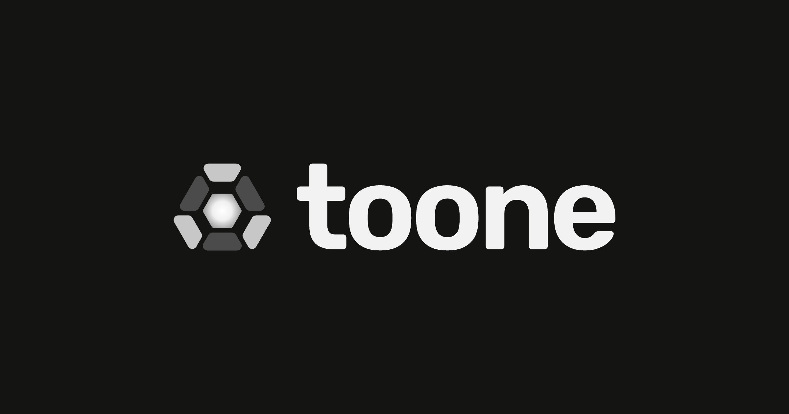

# Toone — the AI workspace for your agentic workflows

Toone is a macOS app for recurring work. Fixed, scripted steps run the same way every time, and AI agents step in only where a step needs judgment: reading, deciding, writing. Think Grokbot meets n8n/zapier. Describe the outcome you want in a conversation, shape it into a routine with an agent, then run it, follow each step and review the output before the next run. A step that falls short pauses so you can fix it and resume.

[Website](https://trytoone.com/en) · [Explore shared routines](https://trytoone.com/en/explore) · [Toone vs n8n, Make and Zapier](https://trytoone.com/en/compare) · [Create an account](https://trytoone.com/en/create-account)

## Start from a shared routine

[Explore](https://trytoone.com/en/explore) is Toone's public library of routines and bundles that people have shared. A few to start from:

- [Find Funding](https://trytoone.com/en/explore/routines/find-funding-hn64ep4n): finds grants, prizes, accelerators and cloud credits that fit your startup, checked on official pages.
- [Find and Apply to Grants](https://trytoone.com/en/explore/bundles/find-and-apply-to-grants-tf7lj72j): adds a dated application plan and drafts, and submits only what you approve.
- [Reddit Radar](https://trytoone.com/en/explore/routines/reddit-radar-rz2orlfe): watches the subreddits you choose, drafts replies in your voice and posts only the ones you approve.
- [Product Launch Essentials](https://trytoone.com/en/explore/bundles/product-launch-essentials-trwv3k5g): prepares your launch-site profiles and runs launch-day outreach with your approval.

What's new: [auto-fix for routines in 1.0.81](https://trytoone.com/en/journal/toone-1-0-81-auto-fix-ai-workflows-routines) and [how Explore listings are reviewed](https://trytoone.com/en/journal/introducing-explore-reviewed-ai-routines).

## From an idea to a repeatable result

The loop behind Toone:

1. **Define the work.** Give a specialised agent a clear responsibility and the project context it should use.
2. **Build the workflow together.** Discuss the intent, input, steps, approvals, and expected output. Toone turns that conversation into a draft routine you can review before publishing.
3. **Run and observe.** Start the routine, follow its graph as steps execute, and open an agent's thread or browser session to see the work in progress.
4. **Review and improve.** Inspect the saved result and run history, change an instruction, and run it again. Useful outputs and project knowledge remain available for the next run.

## What the workspace brings together

| | |
| --- | --- |
| **01 / Build** | Natural-language routines name inputs, responsible agents, steps, completion criteria, and outputs. Compose smaller routines into larger workflows. |
| **02 / Execute** | Specialised agents work with project files, connected tools, and browser sessions. Follow and inspect runs while they happen. |
| **03 / Govern** | Approval points and Project History help people review decisions and changes. For Claude tool results, Safe Mode can screen and redact configured topics. |

Each project keeps its agents, routines, tools, files, and context together. You can start with one useful workflow, then [browse shared routines](https://trytoone.com/en/explore) or add more agents as the work grows.

## Start with one workflow

A complete first run takes about 15 minutes:

1. Install Toone and connect an AI provider. Toone supports OpenAI Codex and Anthropic Claude; bring access to the provider you choose.
2. Create a project to hold the work and its context.
3. Create an agent with one focused responsibility.
4. Create a routine from a useful conversation or a new draft.
5. Run, watch, and improve it using a small, real input.

The full product guide opens after you sign in.

## Access

Toone requires macOS 14 or later and runs on your own Claude Code or OpenAI Codex. Anyone can [create an account](https://trytoone.com/en/create-account), [choose a plan](https://trytoone.com/en/pricing) and download Toone for Mac. Paid plans; free plan coming soon. Existing account holders can [sign in](https://trytoone.com/en/signin).

## This repository

This repository contains the public website, product guide, and product introductions. The macOS application is proprietary; its implementation and installers are maintained separately.

### Website development

Use Node.js 24. Run `npm ci`, `npm run dev`, and `npm run build`. `npm test` validates product content, Explore behavior, and types; `npm run content:check-routes` checks built routes.

Production deploys from `main` through Vercel's Git integration. Merge to `main`; do not run `vercel deploy --prod` from a branch or another checkout, because the next `main` deploy replaces it.

Explore pages use the server-only `EXPLORE_API_BASE_URL` and signed cache revalidation. See [Explore verification](tests/explore/README.md) for the fixture API, production HTTP tests, and manual UI edge cases.

### Sign in with Apple

The sign-in and invitation pages show a Sign in with Apple button (Apple JS, popup mode) only when both public variables are set for the environment:

| Variable | Example |
|---|---|
| `NEXT_PUBLIC_APPLE_SERVICES_ID` | `com.trytoone.web` (the Services ID; public, not a secret) |
| `NEXT_PUBLIC_APPLE_REDIRECT_URI` | `https://trytoone.com/api/auth/apple/callback` (registered Return URL, exact match) |

The button also stays hidden unless the page origin equals the return URL's origin, so set these for Production only. Its visible artwork is generated by Apple's button CDN. The browser forwards only Apple's identity token (plus first-time name and any invitation code) to `POST /auth/apple`; there is no client secret, and the authorization code is discarded. `app/api/auth/apple/callback` never reads its body and redirects to `/signin`. If a Content-Security-Policy is added, allow `https://appleid.cdn-apple.com` for scripts and images and `https://appleid.apple.com` for connections and frames; do not use `Cross-Origin-Opener-Policy: same-origin` on auth pages. Both variables are inlined at build time, so a change takes effect with the next Production build of `main`. Portal and server setup: `docs/operations/sign-in-with-apple.md` in the product monorepo. `npm run test:auth` covers the flow.

Questions and support: [hello@trytoone.com](mailto:hello@trytoone.com).
